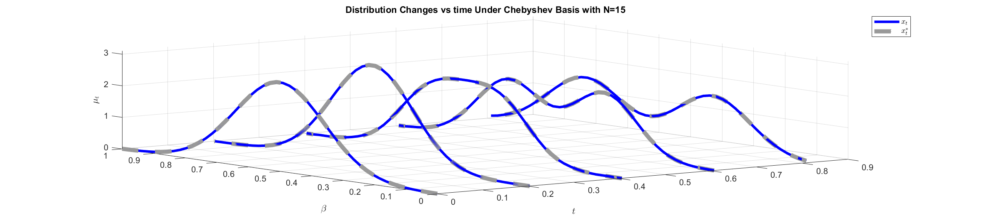

Hi! I'm **Shirley He**. I received my master's degree from **Washington University in St. Louis**, where I developed a strong interest in optimal control, dynamical systems, and numerical optimization.

My research focuses on **ensemble control of parameter-dependent dynamical systems**, with particular interests in moment-based representations, numerical optimal control, and state-constrained optimization.

I am seeking **Ph.D. opportunities for Fall 2027**, particularly in Electrical and Computer Engineering and related areas of Systems and Control.

## Research Interests

- **Optimal Control and Dynamical Systems**
- **Ensemble Control**
- **Numerical Optimization and Computational Methods**
- **Moment-Based Methods and Constrained Control**

I am interested in developing mathematical and computational approaches to control problems, particularly those involving high-dimensional or parameter-dependent dynamical systems.

[Learn more about my research](/research/)
[View My CV](/files/CV2027.pdf)

---

## Selected Research

### 1. Pattern Control of Ensemble Dynamical Systems

**Optimal Control | Ensemble Systems | Numerical Simulation**

Steering parameter-dependent dynamical systems through prescribed geometric configurations using moment-based optimal control.

**Triangle → Square → Maple Leaf**

<video width="100%" controls playsinline preload="metadata">
  <source src="/videos/triangle_square_maple_controls.mp4" type="video/mp4">
  Your browser does not support HTML5 video.
</video>

*Simulation of geometric pattern transformations under shared control inputs.*

[View Project Details](/portfolio/pattern-control/)

---

### 2. Distribution Steering via Moment-Based Optimal Control

**Moment-Based Methods | Distribution Steering | Numerical Optimization**

Investigating the transformation from a unimodal Gaussian distribution toward a bimodal Gaussian mixture using finite-dimensional moment representations.

*Evolution of the ensemble output distribution from a single-peaked Gaussian distribution toward a bimodal Gaussian mixture.*

[View Project Details](/portfolio/distribution-steering/)

---

### 3. State-Constrained Ensemble Optimal Control

**Constrained Optimization | Moment Conditions | Positive Semidefinite Matrices**

Investigating constrained ensemble optimal control through moment-based representations and positive semidefinite conditions, including obstacle avoidance in nonlinear systems.

<video width="100%" controls playsinline preload="metadata">
  <source src="/videos/sq.mp4" type="video/mp4">
  Your browser does not support HTML5 video.
</video>
*Nonlinear ensemble trajectories under state constraints. The red circle represents a forbidden region.*

[View Project Details](/portfolio/state-constrained-control/)

---

## Teaching Experience

**Teaching Assistant — ESE 415: Optimization**  
Washington University in St. Louis

Held weekly office hours, answered students' questions, graded homework assignments, and evaluated midterm and final examinations.

[View Teaching Experience](/teaching/)

---

## Research Notes

Selected mathematical derivations and numerical investigations from my ongoing research are available on the Research Notes page.

These materials are unpublished and are provided to illustrate my research interests and computational work.

[View Research Notes](/research-notes/)

---

## Curriculum Vitae

For more information about my academic background, research experience, and technical skills, please visit my CV page.

[View My CV](/cv/)
