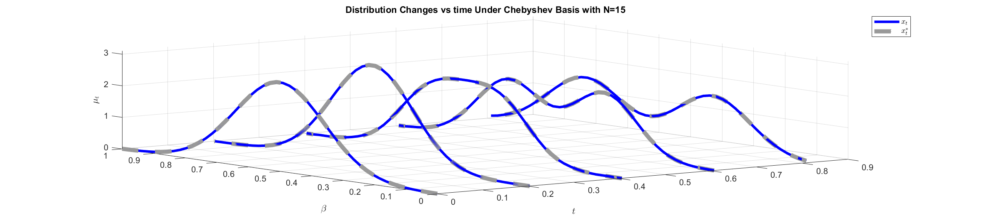
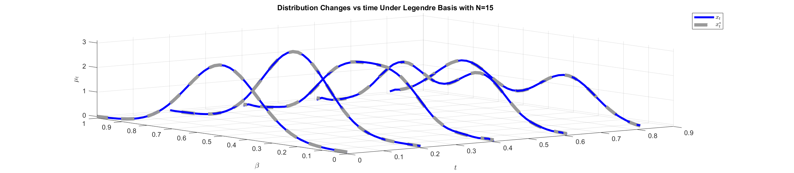
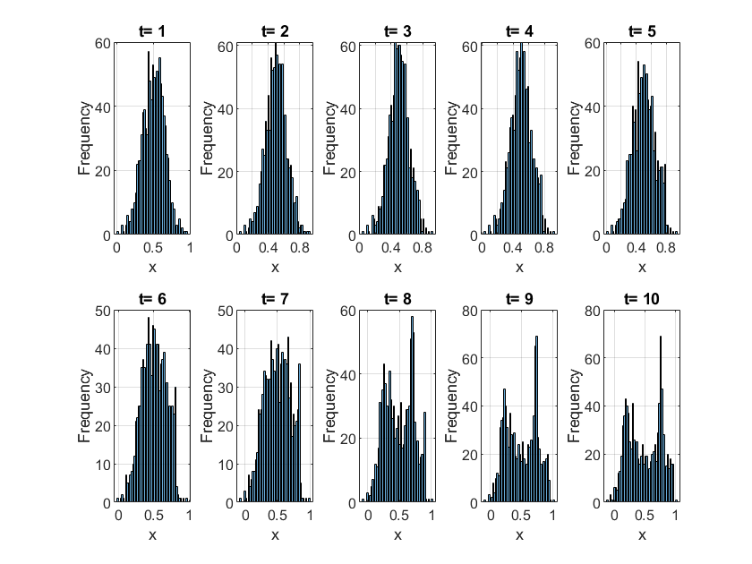
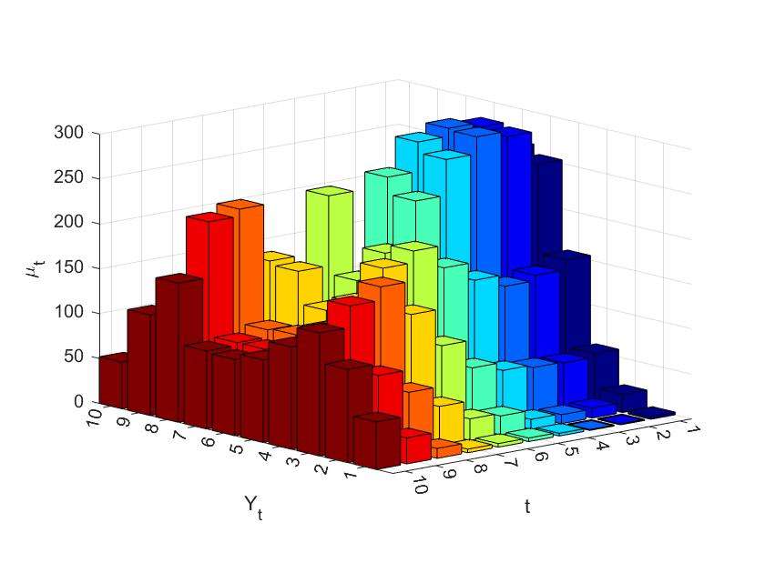

## Overview

This project investigates moment-based approaches to the distributional control of parameter-dependent dynamical systems.

The objective is to steer an ensemble from a truncated Gaussian distribution toward a truncated Gaussian mixture distribution using shared control inputs.

My work primarily focuses on **deriving moment dynamics from the original ensemble system**, constructing finite-dimensional moment representations, and investigating numerical methods for distributional steering.

I considered two types of measurement settings:

- **Labeled measurements:** The system parameter β associated with each state is available.
- **Unlabeled measurements:** Only aggregated observations are available, without identifying which system parameter generated each observation.

These two settings lead to different moment representations and control formulations.

---

## 1. Original Ensemble System

Consider a multi-input, scalar-valued linear ensemble system:

$$
\frac{d}{dt}x(t,\beta)
=
\beta x(t,\beta)
+
\sum_{i=1}^{p}
\psi_{i-1}(\beta)u_i(t),
$$

where:

- x(t, β) represents the state of an individual system.
- β is the ensemble parameter.
- ψᵢ(β) denotes a polynomial basis function.
- uᵢ(t) is a control input applied across the ensemble.
- p is the number of control inputs.

The objective is to design control inputs that steer the ensemble toward a desired terminal configuration or output distribution.

To address the computational challenge of working with a continuously parameterized ensemble, I investigated moment-based representations.

## 2. Moment-Based Transformation

### 2.1 Definition of Ensemble Moments

For a selected basis function ψₖ(β), define the k-th ensemble moment as

$$
m_k(t)
=
\int_{\Omega}
\psi_k(\beta)x(t,\beta)\,d\lambda(\beta).
$$

Differentiating with respect to time yields

$$
\dot{m}_k(t)
=
\int_{\Omega}
\psi_k(\beta)\dot{x}(t,\beta)
\,d\lambda(\beta).
$$

Substituting the original ensemble dynamics gives

$$
\dot{m}_k(t)
=
\int_{\Omega}
\psi_k(\beta)\beta x(t,\beta)
\,d\lambda(\beta)
+
\sum_{i=1}^{p}
u_i(t)
\int_{\Omega}
\psi_k(\beta)\psi_{i-1}(\beta)
\,d\lambda(\beta).
$$

This establishes a connection between the original ensemble dynamics and their representation in the moment domain.

The resulting moment equations depend on the chosen basis functions and their recurrence or orthogonality properties.

## 3. Polynomial Basis Selection

I investigated three polynomial bases to derive and compare the corresponding moment systems.

### 3.1 Monomial Basis

For the monomial basis,

$$
\psi_k(\beta)=\beta^k,
$$

with β ∈ [0, 1], the moment is

$$
m_k(t)
=
\int_0^1
\beta^k x(t,\beta)\,d\beta.
$$

Differentiating and substituting the ensemble dynamics gives

$$
\boxed{
\dot{m}_k(t)
=
m_{k+1}(t)
+
\sum_{i=1}^{p}
\frac{u_i(t)}{k+i}.
}
$$

The corresponding input matrix contains entries

$$
H_{ki}=\frac{1}{k+i}.
$$

These entries form a Hilbert-type matrix, which can become severely ill-conditioned as the system dimension increases.

This creates numerical difficulties, particularly when solving for control inputs through matrix inversion or related numerical procedures.

### 3.2 Legendre Polynomial Basis

For the Legendre representation, I used the recurrence properties of Legendre polynomials to derive the moment dynamics.

With a suitably normalized Legendre basis,

$$
\beta\psi_k(\beta)
=
c_k\psi_{k+1}(\beta)
+
c_{k-1}\psi_{k-1}(\beta).
$$

Consequently,

$$
\dot{m}_k(t)
=
c_km_{k+1}(t)
+
c_{k-1}m_{k-1}(t)
+
\sum_{i=1}^{p}H_{ki}u_i(t).
$$

The coefficients cₖ are determined by the normalization of the polynomial basis.

For an orthonormal Legendre basis, multiplication by β leads to a tridiagonal moment-coupling matrix.

This provides a sparse and structured representation of the original ensemble dynamics.

### 3.3 Chebyshev Polynomial Basis

I also investigated the Chebyshev polynomial representation.

For k ≥ 1, the recurrence relation is

$$
\beta T_k(\beta)
=
\frac{1}{2}
\left(
T_{k+1}(\beta)+T_{k-1}(\beta)
\right).
$$

Using this relation, the drift component of the moment dynamics can be represented through neighboring moments.

The resulting system has a structured matrix representation, with input coefficients depending on the basis normalization and integration measure.

The comparison of these three bases illustrates how polynomial representations influence the structure and numerical properties of moment-based control systems.

## 4. From Ensemble Dynamics to a Moment System

After deriving the individual moment equations, I constructed a truncated moment vector:

$$
m(t)=
\begin{bmatrix}
m_0(t)\\
m_1(t)\\
\vdots\\
m_q(t)
\end{bmatrix}.
$$

The resulting finite-dimensional approximation is expressed as

$$
\boxed{
\dot{m}(t)=Lm(t)+Hu(t).
}
$$

Here:

- L represents the coupling between moments induced by the ensemble dynamics.
- H describes the influence of shared control inputs on the moments.
- q determines the truncation order.

The specific structures of L and H depend on the selected polynomial basis.

### 4.1 Monomial Basis

For the monomial basis, the moment dynamics are

$$
\dot{m}_k(t)
=
m_{k+1}(t)
+
\sum_{i=1}^{p}\frac{u_i(t)}{k+i}.
$$

The corresponding truncated system has the matrix representation

$$
L=
\begin{bmatrix}
0 & 1 & 0 & \cdots & 0\\
0 & 0 & 1 & \cdots & 0\\
\vdots & & \ddots & \ddots & \vdots\\
0 & \cdots & 0 & 0 & 1\\
0 & \cdots & 0 & 0 & 0
\end{bmatrix},
$$

$$
H=
\begin{bmatrix}
1 & \frac12 & \cdots & \frac1p\\
\frac12 & \frac13 & \cdots & \frac1{p+1}\\
\vdots & \vdots & \ddots & \vdots\\
\frac1{q+1} & \frac1{q+2} & \cdots & \frac1{q+p}
\end{bmatrix}.
$$

The matrix L has a shift structure, while H is a Hilbert-type matrix.

Although this representation is straightforward to derive, the input matrix H can become severely ill-conditioned as the truncation order increases, leading to numerical difficulties in control computation.

### 4.2 Legendre Polynomial Basis

For the orthonormal Legendre basis, the recurrence relation leads to

$$
\dot{m}_k(t)
=
c_km_{k+1}(t)
+
c_{k-1}m_{k-1}(t)
+
u_{k+1}(t),
$$

where the last term is present when the corresponding control input is included, and

$$
c_k=
\frac{k+1}
{\sqrt{(2k+1)(2k+3)}}.
$$

The resulting matrices are

$$
L=
\begin{bmatrix}
0 & c_0 & 0 & \cdots & 0\\
c_0 & 0 & c_1 & \ddots & \vdots\\
0 & c_1 & 0 & \ddots & 0\\
\vdots & \ddots & \ddots & \ddots & c_{q-1}\\
0 & \cdots & 0 & c_{q-1} & 0
\end{bmatrix},
$$

$$
H=
\begin{bmatrix}
1 & 0 & \cdots & 0\\
0 & 1 & \cdots & 0\\
\vdots & \vdots & \ddots & \vdots\\
0 & 0 & \cdots & 1
\end{bmatrix}.
$$

Here, H is the identity matrix when p = q + 1.

The Legendre representation produces a symmetric tridiagonal coupling matrix L and a particularly simple input matrix H.

This structure is advantageous for numerical implementation and avoids the Hilbert-type input matrix arising from the monomial basis.

### 4.3 Chebyshev Polynomial Basis

For the Chebyshev basis, the recurrence relation gives

$$
\beta T_k(\beta)
=
\frac12
\left(
T_{k+1}(\beta)+T_{k-1}(\beta)
\right),
\quad k\geq1.
$$

Using the matrix convention presented in the computational study, the truncated moment system is represented by

$$
L=
\begin{bmatrix}
0 & \frac12 & 0 & \cdots & 0\\
\frac12 & 0 & \frac12 & \ddots & \vdots\\
0 & \frac12 & 0 & \ddots & 0\\
\vdots & \ddots & \ddots & \ddots & \frac12\\
0 & \cdots & 0 & \frac12 & 0
\end{bmatrix},
$$

$$
H=
\begin{bmatrix}
\pi & 0 & \cdots & 0\\
0 & \frac{\pi}{2} & \cdots & 0\\
\vdots & \vdots & \ddots & \vdots\\
0 & 0 & \cdots & \frac{\pi}{2}
\end{bmatrix}.
$$

The Chebyshev representation also produces a sparse coupling matrix, while the input matrix has a diagonal structure under the corresponding weighted inner product.

As with the Legendre basis, the structured matrices provide a convenient representation for numerical optimal control.

### 4.4 Comparison of Moment Representations

The three polynomial bases lead to different matrix structures:

| Basis | Matrix L | Matrix H |
|---|---|---|
| Monomial | Shift matrix | Hilbert-type |
| Legendre | Symmetric tridiagonal | Identity |
| Chebyshev | Tridiagonal | Diagonal |

The comparison illustrates how selecting different polynomial bases changes the numerical properties of the moment system.

In particular, the monomial representation may suffer from severe ill-conditioning, whereas orthogonal polynomial representations can lead to more structured input matrices.

These observations motivated further numerical comparisons of distribution steering performance and approximation accuracy.

## 5. Optimal Control Formulation

After constructing the moment system, I investigated optimal control formulations in the moment domain.

### 5.1 Fixed-Endpoint Control

A representative objective is to minimize control energy:

$$
\min_u
\int_0^T
\|u(t)\|^2\,dt
$$

subject to

$$
\dot{m}(t)=Lm(t)+Hu(t),
$$

$$
m(0)=m_0,
\qquad
m(T)=m_{\mathrm{target}}.
$$

### 5.2 Moment Trajectory Tracking

For a prescribed target moment trajectory m*(t), the tracking problem can be formulated as

$$
\min_u
\int_0^T
\|m(t)-m^*(t)\|^2\,dt.
$$

These formulations provide computational approaches for controlling the desired ensemble configuration through its finite-dimensional moment representation.

---

## 6. Numerical Experiments: Labeled Measurements

### 6.1 Measurement Setting

In the labeled setting, each observation retains the association between the system parameter β and the corresponding state x(t, β).

Therefore, the ensemble state can be represented through moments of the form

$$
m_k(t)
=
\int_{\Omega}
\psi_k(\beta)x(t,\beta)\,d\lambda(\beta).
$$

This is the setting used in the polynomial-basis derivations above.

### 6.2 Gaussian-to-Gaussian-Mixture Steering

I investigated the transformation from a truncated Gaussian distribution toward a truncated Gaussian mixture distribution.

The numerical experiments compare different moment representations and show the evolution of the computed state xₜ against the target profile xₜ*.

In the figures below:

- **Blue solid line** denotes the computed state xₜ.
- **Grey dashed line** denotes the target state xₜ*.

### Simulation Results

**Chebyshev Basis**

*Distribution steering under the Chebyshev basis. The blue solid line represents the computed state xₜ, and the grey dashed line represents the target state xₜ*. The Chebyshev representation provides a structured moment system and favorable numerical behavior.*

**Legendre Basis**

*Distribution steering under the Legendre basis. The blue solid line represents the computed state xₜ, and the grey dashed line represents the target state xₜ*. The Legendre basis yields a structured tridiagonal moment coupling matrix and performs well in the numerical experiments.*

---

## 7. Numerical Experiments: Unlabeled Measurements

### 7.1 Aggregated Measurements without Labels

I also examined distributional control in a setting where individual system labels are unavailable.

Unlike the labeled case, the observed data no longer contain the correspondence between the system parameter β and the state x(t, β).

Instead, the available information consists of aggregated measurements of the ensemble states.

Consider the same class of parameter-dependent linear systems:

$$
\frac{d}{dt}x(t,\beta)
=
\beta x(t,\beta)
+
\sum_{i=1}^{p}
\beta^{i-1}u_i(t).
$$

With an identity output function, the observed output is

$$
y(t,\beta)=x(t,\beta).
$$

However, the individual parameter β associated with each observation is not available.

The control objective is therefore formulated in terms of the distribution of the ensemble outputs rather than the labeled state function.

### 7.2 Output Distribution and Moment Representation

Let μₜ denote the probability measure induced by the aggregated ensemble observations.

Using the pushforward representation,

$$
\mu_t=(x_t)_{\#}\lambda,
$$

where λ is the parameter-space probability measure.

For the monomial basis, the k-th moment of the output distribution is defined as

$$
m_k(t)
=
\int_{\mathbb{R}}
y^k\,d\mu_t(y).
$$

By the definition of the pushforward measure,

$$
\boxed{
m_k(t)
=
\int_0^1
x(t,\beta)^k\,d\beta.
}
$$

This is the key distinction from the labeled case.

In the labeled setting, moments are obtained by integrating the state against basis functions of β.

In the unlabeled setting, moments are calculated directly from the output distribution.

Thus, the unlabeled moments describe statistical properties of the ensemble without requiring individual parameter-state associations.

### 7.3 Moment Dynamics for Unlabeled Outputs

Differentiating the distributional moments gives

$$
\dot{m}_k(t)
=
k\int_0^1
x(t,\beta)^{k-1}
\dot{x}(t,\beta)\,d\beta.
$$

Substituting the original ensemble dynamics yields

$$
\dot{m}_k(t)
=
k\int_0^1
\beta x(t,\beta)^k\,d\beta
+
k\sum_{i=1}^{p}u_i(t)
\int_0^1
\beta^{i-1}x(t,\beta)^{k-1}\,d\beta.
$$

Unlike the labeled moment equations, this representation generally involves mixed terms containing both β and x(t, β).

Consequently, the unlabeled moment dynamics do not automatically reduce to the same linear system derived for labeled measurements.

This distinction motivates a distributional control formulation using moments of the output measure.

### 7.4 Optimal Transport and Moment Tracking

For the unlabeled setting, a target distributional trajectory can be constructed using optimal transport.

Let μ₀ and μ₁ denote the initial and target distributions.

A reference distribution trajectory μₜ* can be generated through displacement interpolation between these two distributions.

The associated target moment trajectory is

$$
m_k^*(t)
=
\int_{\mathbb{R}}
y^k\,d\mu_t^*(y).
$$

The distributional control problem can then be studied as a moment-tracking problem.

For an order-q truncated moment representation, a representative optimal tracking formulation is

$$
\min_u
\int_0^1
d_M
\left(
P_qm^*(t),
\hat{m}^{q}(t)
\right)\,dt
$$

subject to the corresponding truncated moment dynamics.

Here:

- μₜ* is the target distributional trajectory.
- m*(t) denotes its moment sequence.
- Pq denotes truncation to the selected moment order.
- m̂ᵠ(t) represents the controlled truncated moment trajectory.
- dM measures the discrepancy between the moment representations.

This approach allows distributional steering to be formulated without explicitly matching the states of individual labeled systems.

### 7.5 Unlabeled Distribution Steering Experiment

The unlabeled experiment considers steering the ensemble output distribution from a truncated Gaussian distribution toward a truncated Gaussian mixture distribution.

The reported numerical setting uses:

- **Measurement type:** Unlabeled aggregated measurements
- **Moment basis:** Monomial basis
- **Moment truncation order:** q = 8
- **Number of control inputs:** p = 8
- **Number of sampled systems for visualization:** 1000
- **Control interval:** t ∈ [0, 1]

The resulting controlled distributions are evaluated at

t = 0, 0.2, 0.4, 0.6, 0.8, and 1.

The simulation illustrates the evolution of the empirical output distribution under the computed control inputs.

**Unlabeled distribution evolution figure: To be added.**

**Control input figure: To be added.**

### 7.6 Simulation Results: Distribution Evolution

The following simulations illustrate the evolution of the ensemble output distribution under the designed control inputs in the unlabeled measurement setting.

Starting from an approximately Gaussian distribution with a single peak, the ensemble gradually evolves toward a bimodal Gaussian mixture distribution, characterized by two distinct peaks.

#### Histogram Visualization

*Figure 1. Evolution of the empirical state distribution at ten consecutive time steps.*

Each histogram represents the distribution of ensemble states at a particular time step.

- **Horizontal axis (x):** The values of the individual ensemble states x(t, β). Each bar corresponds to a specific interval of state values (bin).
- **Vertical axis (Frequency):** The number of individual systems whose state values fall within the corresponding interval. Taller bars indicate that more systems have state values within that range.
- **Time steps (t = 1, ..., 10):** The ten panels illustrate how the distribution evolves under the applied control inputs.

At the beginning, most state values are concentrated around a single central peak, forming an approximately Gaussian distribution.

As time progresses, the state values gradually redistribute. The initially unimodal distribution develops two distinct peaks, approaching the desired bimodal Gaussian mixture distribution.

This illustrates how the control inputs reshape the distribution of the ensemble as a whole, even when individual system labels are unavailable.

#### 3D Visualization of Distribution Evolution

*Figure 2. Three-dimensional visualization of the evolution from a unimodal Gaussian distribution toward a bimodal Gaussian mixture.*

The three axes represent:

- **Yₜ:** The observed state values, grouped into intervals.
- **t:** The simulation time, progressing from the back toward the front of the figure.
- **μₜ (Frequency):** The number of ensemble states falling within each value interval at a given time.

Each row of bars represents a histogram at a particular time step. The height of each bar indicates how many individual systems have state values within the corresponding interval.

Reading the figure from back to front, the initially concentrated, single-peaked distribution gradually separates into two peaks.

The 3D visualization provides a continuous perspective on the redistribution of ensemble states over time and illustrates the Gaussian-to-Gaussian-mixture steering process.

---

## 8. Key Research Work

My work on this project focuses on the computational aspects of moment-based distributional control.

The main areas include:

1. **Moment-Based Transformation:** Deriving moment representations for parameter-dependent ensemble systems.

2. **Polynomial Basis Investigation:** Studying monomial, Legendre, and Chebyshev bases and their corresponding moment dynamics.

3. **Finite-Dimensional Control:** Formulating the labeled ensemble control problem in the form ṁ = Lm + Hu.

4. **Numerical Optimal Control:** Investigating fixed-endpoint and moment-tracking formulations.

5. **Distributional Control Experiments:** Studying Gaussian-to-Gaussian-mixture steering and comparing numerical behavior across different representations.

6. **Unlabeled Measurement Setting:** Examining the use of output-distribution moments when individual system labels are unavailable.

## Research Status

This page presents selected mathematical derivations and computational investigations from ongoing, collaborative research.

The labeled case focuses on moment-system derivation and numerical control using polynomial bases. The unlabeled case illustrates a related distributional-control formulation based on aggregated measurements and optimal transport.

These materials are not presented as peer-reviewed publications.
