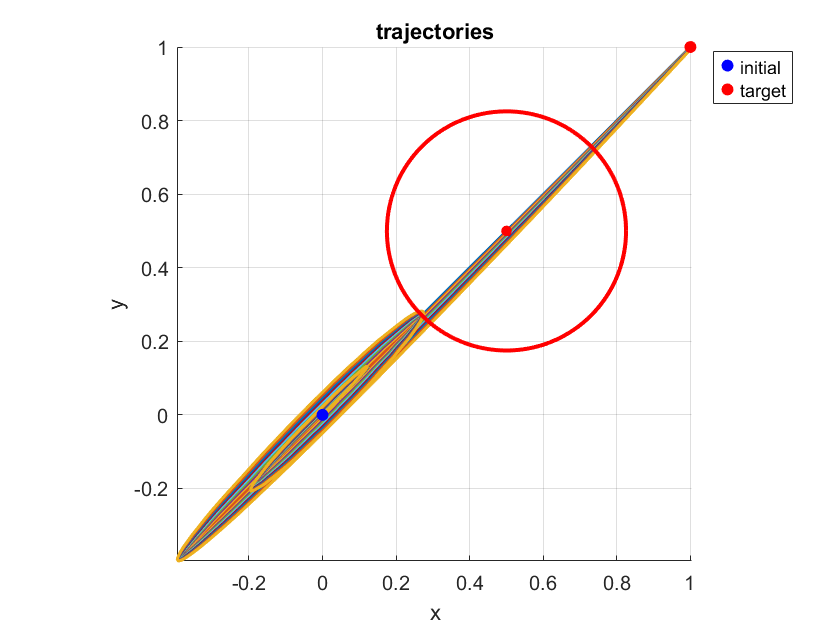
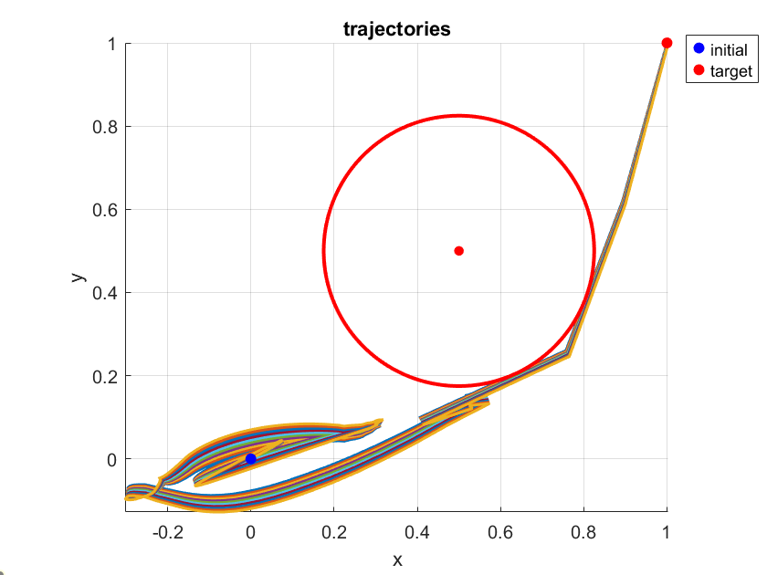
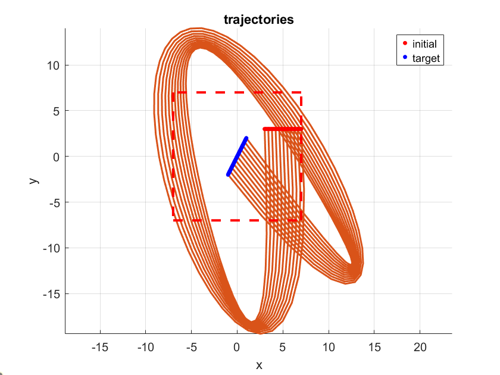
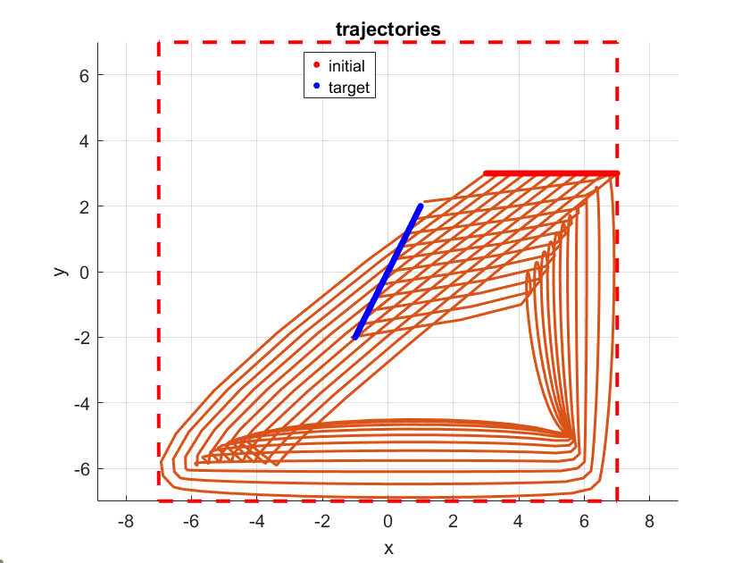

## Overview

This project investigates **state-constrained optimal control of parameter-dependent ensemble systems**.

A common control input must steer an entire family of dynamical systems while satisfying inequalities over a continuous parameter domain. Directly checking the constraints for every parameter is generally difficult.

My primary focus is **Constrained Ensemble Control in Moment Coordinates**: transforming state inequalities into conditions on moments, examining when those conditions are necessary or sufficient, and analyzing finite-dimensional approximations of the constrained optimal control problem.

The work includes weighted integral constraints, positive semidefinite (PSD) moment matrices, and a two-stage convergence argument for state and constraint truncations.

## 1. Problem Formulation

Consider a parameter-dependent ensemble system

$$
\dot{x}(t,\beta)=F(x(t,\beta),\beta,u(t)),
\qquad \beta\in\Omega=[a,b],
$$

where x(t, β) is the state of the system indexed by β and u(t) is a shared control input.

A general optimal control problem includes an integral terminal and running cost:

$$
\min_u J(u)=
\int_{\Omega}
\left[
\Phi(T,x(T,\beta))
+
\int_0^T
\mathcal{L}(t,x(t,\beta),u(t))\,dt
\right]d\beta.
$$

The optimization is subject to the ensemble dynamics, boundary conditions, and a constraint required across the parameter domain.

For the analysis below, write the inequality in the nonnegative convention:

$$
g(t,\beta;u)
=
h(x(t,\beta),u(t))
\geq 0,
\qquad \forall\beta\in\Omega.
$$

A condition originally expressed as h ≤ 0 can equivalently be written in this convention by replacing h with −h.

Unless otherwise specified, the mathematical arguments below apply at a fixed time or at selected constraint-checking times. Enforcing constraints only on a time grid does not by itself guarantee feasibility between those times.

## 2. Moment Coordinates for the Ensemble State

Choose an orthonormal basis of functions on Ω, denoted by ψₖ(β).

Define the ensemble moments:

$$
m_k(t)=
\int_{\Omega}
\psi_k(\beta)x(t,\beta)\,d\beta.
$$

The full moment sequence represents the ensemble state in the corresponding function space.

An order-N reconstruction is

$$
x_N(t,\beta)=
\sum_{k=0}^{N}
m_k(t)\psi_k(\beta).
$$

This representation allows the original cost and state constraints to be evaluated using the reconstructed state x_N instead of the full state function x.

The key question is then how to impose a continuum inequality on this moment-based representation.

## 3. Weighted Integral Constraints: Necessary but Not Sufficient

If the pointwise constraint g(t, β; u) ≥ 0 holds, then its integral against any nonnegative weight must also be nonnegative.

In particular, for k = 0, 1, 2, ...,

$$
\boxed{
\int_a^b
(\beta-a)^k g(t,\beta;u)\,d\beta
\geq 0.
}
$$

These inequalities are **necessary conditions** for pointwise feasibility.

However, they are not sufficient, even if all of these particular monomial-weighted inequalities hold.

### 3.1 Counterexample

Consider the interval [0, 1] and the continuous function

$$
g(\beta)=\beta-\varepsilon,
\qquad
0<\varepsilon\leq\frac12.
$$

The function violates nonnegativity on [0, ε).

Nevertheless,

$$
\begin{aligned}
I_k
&=
\int_0^1
\beta^k(\beta-\varepsilon)\,d\beta\\
&=
\frac{1}{k+2}
-
\frac{\varepsilon}{k+1}.
\end{aligned}
$$

Therefore,

$$
I_k\geq0
\quad\Longleftrightarrow\quad
\varepsilon\leq
\frac{k+1}{k+2}.
$$

Since the minimum of the right-hand side over all nonnegative integers k is 1/2, every one of the displayed integral inequalities holds whenever 0 < ε ≤ 1/2, despite the interval on which g is negative.

### 3.2 Interpretation

This counterexample demonstrates that **nonnegative weighted integrals do not necessarily guarantee pointwise nonnegativity**.

Testing only selected nonnegative weights may overlook a local constraint violation.

This motivates richer positivity certificates built from products of basis functions.

## 4. Positive Semidefinite Constraints in Moment Coordinates

For a scalar constraint function g(β), define its coefficients in a suitable basis φₖ:

$$
c_k=
\int_a^b
\phi_k(\beta)g(\beta)\,d\beta.
$$

Construct a finite matrix using products of basis functions:

$$
\boxed{
Q_K(g)_{ij}
=
\int_a^b
\overline{\phi_i(\beta)}
\phi_j(\beta)
g(\beta)\,d\beta,
\quad 0\leq i,j<K.
}
$$

For every vector z of compatible dimension,

$$
\begin{aligned}
z^*Q_K(g)z
&=
\int_a^b
g(\beta)
\left|
\sum_{j=0}^{K-1}
z_j\phi_j(\beta)
\right|^2d\beta.
\end{aligned}
$$

Thus, if g(β) ≥ 0, then

$$
\boxed{
Q_K(g)\succeq0
\qquad\text{for every }K.
}
$$

Conversely, when the chosen test-function family is sufficiently rich to approximate continuous functions on the domain, positivity of every finite principal matrix implies nonnegativity of the integral against arbitrary nonnegative continuous test functions.

This yields g ≥ 0 almost everywhere; when g is continuous, it yields pointwise nonnegativity.

A single finite PSD constraint generally remains only a necessary relaxation.

### 4.1 Monomial Basis: Hankel Matrix

With the monomial basis,

$$
\phi_k(\beta)=\beta^k,
$$

the matrix entries become

$$
Q_K(g)_{ij}=c_{i+j}.
$$

Therefore, the constraint matrix has a Hankel structure:

$$
Q_K(g)=
\begin{bmatrix}
c_0&c_1&c_2&\cdots\\
c_1&c_2&c_3&\cdots\\
c_2&c_3&c_4&\cdots\\
\vdots&\vdots&\vdots&\ddots
\end{bmatrix}_{K\times K}
\succeq0.
$$

The Hankel matrix encodes the moments of the constrained function and provides a structured representation of the positivity condition.

### 4.2 Fourier Basis: Toeplitz Matrix

For a suitable periodic parameter domain, choose the Fourier basis

$$
\phi_k(\beta)=e^{ik\beta}.
$$

Define the Fourier coefficients

$$
c_r=
\int_{\Omega}
e^{ir\beta}g(\beta)\,d\beta.
$$

Because g is real-valued, the coefficients satisfy

$$
c_{-r}=\overline{c_r}.
$$

With a consistent complex-conjugation convention,

$$
Q_K(g)_{ij}=c_{j-i}.
$$

The resulting matrix is Hermitian Toeplitz:

$$
Q_K(g)=
\begin{bmatrix}
c_0&c_1&c_2&\cdots\\
c_{-1}&c_0&c_1&\cdots\\
c_{-2}&c_{-1}&c_0&\cdots\\
\vdots&\vdots&\vdots&\ddots
\end{bmatrix}.
$$

The Toeplitz–Herglotz positivity criterion motivates the PSD representation of a nonnegative measure in the periodic setting.

### 4.3 Legendre Polynomial Basis

For Legendre polynomials, the product of two basis functions can be expanded as

$$
P_i(\beta)P_j(\beta)
=
\sum_{r=0}^{\min(i,j)}
d_{ijr}P_{i+j-2r}(\beta).
$$

Consequently,

$$
\boxed{
Q_K(g)_{ij}
=
\sum_{r=0}^{\min(i,j)}
d_{ijr}c_{i+j-2r}.
}
$$

The coefficients dᵢⱼᵣ depend on the normalization convention.

The product-expansion formula makes it possible to construct the constraint matrix from a finite set of moments of the constrained function.

### 4.4 Chebyshev Polynomial Basis

For standard Chebyshev polynomials,

$$
T_i(\beta)T_j(\beta)
=
\frac12
\left[
T_{i+j}(\beta)
+
T_{|i-j|}(\beta)
\right].
$$

Using the same integration measure in the definitions of cₖ and Q_K,

$$
\boxed{
Q_K(g)_{ij}
=
\frac12
\left(
c_{i+j}+c_{|i-j|}
\right).
}
$$

The resulting matrix has a structured combination of Hankel-like and Toeplitz-like terms.

The particular polynomial normalization and integration measure must be kept consistent when implementing this formula.

### 4.5 Comparison of PSD Representations

| Polynomial Basis | Matrix Structure | Main Property |
|---|---|---|
| Monomial | Hankel | Entries depend on cᵢ₊ⱼ |
| Fourier | Toeplitz | Entries depend on the index difference |
| Legendre | Structured moment matrix | Constructed through polynomial product expansions |
| Chebyshev | Hankel-like and Toeplitz-like | Uses sum and difference of indices |

The main advantage of these representations is that state inequalities can be investigated through structured matrices defined by moments of the constrained function.

Instead of checking the state constraint at a few sampled parameter values, moment-based PSD matrices encode integrals of g against squares of test functions.

Increasing K enlarges the family of constraint tests.

## 5. Finite-Dimensional Optimal Control Formulation

Discretize the control as piecewise constant over L time intervals and stack its components into U.

For a linear truncated moment model, write

$$
\dot{m}(t)=Am(t)+Bu(t).
$$

With step length Δt, let

$$
A_d=e^{A\Delta t},
\qquad
B_d=
\int_0^{\Delta t}
e^{A\tau}B\,d\tau.
$$

The terminal moment vector can be expressed as

$$
m_L=A_d^Lm_0+C_LU,
$$

where

$$
C_L=
\begin{bmatrix}
A_d^{L-1}B_d&
A_d^{L-2}B_d&
\cdots&
B_d
\end{bmatrix}.
$$

For a prescribed terminal moment vector m_target, the boundary condition becomes

$$
C_LU=
m_{\mathrm{target}}-A_d^Lm_0.
$$

### 5.1 Minimum-Energy Control

A representative minimum-energy objective is

$$
\min_U \|U\|^2
$$

subject to the terminal conditions and moment-based state constraints.

Under a minimum-energy objective, a Schur-complement epigraph formulation introduces a symmetric matrix W:

$$
\begin{aligned}
\min_{U,W}\quad&
\operatorname{tr}(W)\\
\text{subject to}\quad&
\begin{bmatrix}
W&U\\
U^\top&1
\end{bmatrix}
\succeq0,\\
&
C_LU=
m_{\mathrm{target}}-A_d^Lm_0,\\
&
Q_K^{(\ell)}(U)
\succeq0
\quad
\text{at each tested time }t_\ell.
\end{aligned}
$$

The block-matrix inequality implies

$$
W\succeq UU^\top
$$

and hence bounds the discrete quadratic control effort.

With a uniform time step, the physical control energy also includes the constant factor Δt.

The energy epigraph and the linear terminal constraint are semidefinite or affine representable.

However, if the constraint function or the state depends nonlinearly on U, then Q_K(U) may also be nonlinear.

Therefore, the overall constrained problem is not automatically a convex SDP.

## 6. Convergence Analysis of Truncated Constrained Problems

An important part of my research concerns the mathematical relationship between finite-dimensional approximations and the original constrained ensemble control problem.

The analysis involves two approximation levels:

- **N:** The number of retained state moments used to reconstruct x_N.
- **K:** The dimension of the PSD constraint matrix Q_K.

These serve different purposes.

Increasing N improves the state representation, while increasing K strengthens the constraint approximation.

### 6.1 Three Optimization Problems

Let the admissible discrete controls U belong to a compact set.

At each tested time tₗ, define the true constraint matrix Q_K and its state-truncated counterpart Q_N,K, obtained by replacing x with x_N.

The infinite-constraint problem is

$$
\boxed{
v_\infty
=
\min_{U\in\mathcal U}J(U)
\quad
\text{subject to }
Q_\infty^{(\ell)}(U)\succeq0
\quad\forall\ell.
}
$$

The finite-constraint problem is

$$
\boxed{
v_K
=
\min_{U\in\mathcal U}J(U)
\quad
\text{subject to }
Q_K^{(\ell)}(U)\succeq0
\quad\forall\ell.
}
$$

Finally, the fully approximated problem uses both a truncated state and a small PSD tolerance:

$$
\boxed{
v_{N,K}
=
\min_{U\in\mathcal U}J_N(U)
\quad
\text{subject to }
Q_{N,K}^{(\ell)}(U)
\succeq-\varepsilon_N I
\quad\forall\ell.
}
$$

The relaxation ε_N is chosen to approach zero while accommodating the state-truncation error in the constraint matrices.

### 6.2 Proof Ingredient I: Continuity of the Constraint Matrices

Consider two admissible discrete controls U and V.

Under the Lipschitz assumptions on the ensemble vector field and on the constraint function, the state difference satisfies a Grönwall-type estimate of the form

$$
\|x(t_\ell,\cdot;U)-x(t_\ell,\cdot;V)\|_{L^1(\Omega)}
\leq
C_\ell\|U-V\|.
$$

Applying the Lipschitz bound for the constraint function gives

$$
\|g^{(\ell)}(\cdot;U)-g^{(\ell)}(\cdot;V)\|_{L^1(\Omega)}
\leq C'_\ell\|U-V\|.
$$

Because each finite matrix entry is an integral of this constraint function against fixed bounded test functions, for every fixed K there is a constant C_ℓ,K such that

$$
\boxed{
\|Q_K^{(\ell)}(U)-Q_K^{(\ell)}(V)\|_2
\leq C_{\ell,K}\|U-V\|.
}
$$

Therefore, the finite PSD feasible sets are closed.

Together with compactness of the admissible control set, this supports the existence of minimizers whenever those feasible sets are nonempty.

### 6.3 Proof Ingredient II: Uniform Constraint-Matrix Approximation

For fixed K, the reconstructed state x_N leads to approximate constraint coefficients.

Their error can be bounded by

$$
\begin{aligned}
|c_{r,N}^{(\ell)}(U)-c_r^{(\ell)}(U)|
&\leq
\|\phi_r\|_\infty
\|g_N^{(\ell)}(\cdot;U)
-g^{(\ell)}(\cdot;U)\|_{L^1(\Omega)}\\
&\leq
C_r
\|x_N(t_\ell,\cdot;U)
-x(t_\ell,\cdot;U)\|_{L^1(\Omega)}.
\end{aligned}
$$

Since Q_K contains finitely many such coefficients, provided the state reconstructions converge uniformly over admissible controls in the required norm, there is a sequence δ_N → 0 such that

$$
\boxed{
\sup_{U\in\mathcal U}
\|Q_{N,K}^{(\ell)}(U)
-Q_K^{(\ell)}(U)\|_2
\leq\delta_N.
}
$$

Assume similarly that the approximate cost satisfies

$$
\sup_{U\in\mathcal U}
|J_N(U)-J(U)|
\leq\alpha_N,
\qquad
\alpha_N\to0.
$$

These uniform estimates are the central approximation hypotheses in the convergence argument.

Pointwise convergence alone is not sufficient to substitute for them.

### 6.4 Step I of the Proof: Fix K, Then Let N Increase

Choose ε_N ≥ δ_N with ε_N → 0.

Let U_K be an optimizer of the finite-constraint problem.

Since Q_K(U_K) is PSD, the smallest-eigenvalue perturbation bound implies

$$
\lambda_{\min}
\left(
Q_{N,K}^{(\ell)}(U_K)
\right)
\geq
-\delta_N
\geq
-\varepsilon_N.
$$

Thus, U_K is feasible for the relaxed N-truncated problem, yielding

$$
\boxed{
v_{N,K}
\leq
J_N(U_K)
\leq
v_K+\alpha_N.
}
$$

For the opposite bound, take optimizers U_N,K of the approximate problems.

Compactness gives a convergent subsequence with limit Ū.

Passing to the limit in the PSD inequalities using ε_N → 0, δ_N → 0, and continuity of Q_K shows that Ū is feasible for the K-constraint problem.

Using the uniform objective bound and continuity of J then gives the reverse inequality on the limiting optimal values.

Combining both directions,

$$
\boxed{
\lim_{N\to\infty}v_{N,K}=v_K
\quad\text{for fixed }K.
}
$$

Every accumulation point of the corresponding approximate minimizers is an optimizer of the K-constraint problem.

### 6.5 Step II of the Proof: Increase the Constraint Order K

Define the exact-state finite feasible sets

$$
\mathcal F_K
=
\left\{
U\in\mathcal U:
Q_K^{(\ell)}(U)\succeq0
\text{ for all tested }\ell
\right\}.
$$

Because each higher-order matrix contains the previous matrix as a principal block,

$$
\boxed{
\mathcal F_{K+1}
\subseteq
\mathcal F_K,
\qquad
\mathcal F_\infty
=
\bigcap_{K=1}^{\infty}
\mathcal F_K.
}
$$

Consequently, the minimization is performed over increasingly restrictive feasible sets, and the optimal values satisfy

$$
\boxed{
v_K\leq v_{K+1}\leq v_\infty.
}
$$

Assuming the limiting feasible set is nonempty and the relevant feasible sets are compact, the sequence of optimal values converges to the infinite-constraint optimum:

$$
\boxed{
\lim_{K\to\infty}v_K=v_\infty.
}
$$

To see why, select optimizers U_K.

Compactness provides a convergent subsequence.

The nested, closed constraints force its limit to belong to every feasible set and therefore to their intersection.

Continuity of J shows that this limit achieves the limiting optimal value.

### 6.6 Interpretation of the Proof

The two steps establish a logical route from finite computations to the constrained ensemble problem:

1. **N → ∞ at fixed K:** Recover the correct K-dimensional PSD-constrained optimization problem from moment-based state reconstructions.

2. **K → ∞:** Recover the full family of PSD tests for constraint nonnegativity over the parameter domain.

The mathematical conclusion is that the optimal values converge, and accumulation points of optimal controls solve the limiting problem.

Convergence of the entire sequence of optimal controls to one particular control requires additional conditions, such as uniqueness of the limiting optimizer.

The argument concerns the chosen constraint-checking times. Additional time regularity or continuous-time constraint enforcement is required to conclude feasibility for every time in [0, T].

---

## 7. Simulation Results

To investigate the effect of state constraints on ensemble optimal control, I conducted two numerical experiments involving an ensemble of harmonic oscillators.

The experiments consider two geometric steering tasks:

1. **Point-to-Point Control with a Forbidden Region**
2. **Line-to-Line Control with Boundary Constraints**

For each task, I compared the original unconstrained trajectories with those obtained after incorporating state constraints into the optimal control formulation.

These experiments illustrate how constraints influence the geometric behavior of ensemble trajectories while steering the systems toward prescribed targets.

---

### 7.1 Case I: Point-to-Point Control with a Forbidden Region

#### Problem Setup

The objective is to steer an ensemble of systems from the initial point (0, 0) toward the target point (1, 1), using a shared control input.

A circular forbidden region is introduced in the state space, centered approximately at (0.5, 0.5).

The control objective is to reach the target while avoiding the forbidden region.

In the following figures:

- **Blue point:** Initial state
- **Red point:** Target state
- **Red circle:** Forbidden region
- **Colored curves:** Trajectories of individual systems in the ensemble

#### Without State Constraints

*Figure 1. Point-to-point ensemble control without state constraints.*

Without state constraints, the computed trajectories follow approximately direct paths from the initial point to the target.

Although the ensemble approaches the desired terminal state, the trajectories pass through the circular forbidden region.

This illustrates a limitation of unconstrained optimal control: achieving the terminal objective does not necessarily guarantee that intermediate states satisfy additional geometric or safety requirements.

#### With State Constraints

*Figure 2. Point-to-point ensemble control with a circular forbidden region.*

After incorporating the state constraints, the computed trajectories change significantly.

Instead of following approximately straight paths, the ensemble trajectories bend around the circular obstacle while progressing toward the target state.

The resulting paths demonstrate how the constrained control formulation changes the evolution of the ensemble to account for the forbidden region.

**Key Observation:** The state constraints reshape the trajectories, allowing the control problem to account for obstacle avoidance in addition to terminal-state steering.

---

### 7.2 Case II: Line-to-Line Control with Boundary Constraints

#### Problem Setup

The second experiment considers a line-to-line steering problem.

The objective is to drive an ensemble from an initial line segment toward a prescribed target line segment.

A rectangular admissible region is introduced to restrict the state trajectories within specified boundaries.

In the following figures:

- **Red solid line:** Initial line segment
- **Blue solid line:** Target line segment
- **Red dashed rectangle:** Admissible state region
- **Orange curves:** Trajectories of individual systems in the ensemble

The objective is to steer the ensemble toward the target line while respecting the prescribed state boundaries.

#### Without State Constraints

*Figure 3. Line-to-line ensemble control without state constraints.*

Without explicitly imposing state constraints, the trajectories exhibit large excursions in the state space.

Several individual trajectories extend well beyond the prescribed rectangular boundaries before approaching the target line.

Although the control input is designed to achieve the desired terminal configuration, the intermediate trajectories can deviate substantially from the admissible region.

This demonstrates why terminal-state accuracy alone is insufficient for constrained ensemble control problems.

#### With State Constraints

*Figure 4. Line-to-line ensemble control with rectangular state constraints.*

After introducing boundary constraints, the ensemble trajectories exhibit a more confined evolution.

Compared with the unconstrained case, the large excursions outside the rectangular region are substantially reduced.

The trajectories remain visually concentrated within the prescribed boundaries while steering the ensemble toward the target line.

The constrained solution illustrates how state restrictions can regulate intermediate trajectories without abandoning the terminal steering objective.

**Key Observation:** The addition of state constraints significantly reduces excessive trajectory excursions and produces paths that better respect the admissible state region.

---

## 8. Research Focus and Takeaways

The main topics developed in this project are:

1. **Moment-Domain Constraint Representation:** Rewriting parameter-dependent state inequalities as moment-based integral and matrix conditions.

2. **Necessary versus Sufficient Conditions:** Demonstrating why selected weighted integral inequalities can fail to detect local constraint violations.

3. **Structured PSD Matrices:** Constructing Hankel, Toeplitz, Legendre, and Chebyshev representations from moments of the constrained function.

4. **Finite-Dimensional Optimization:** Combining moment dynamics, terminal conditions, quadratic control cost, and PSD constraints.

5. **Approximation Analysis:** Investigating the limits N → ∞ and K → ∞ and the assumptions needed for convergence of optimal values and minimizers.

## Research Status

This page summarizes selected mathematical formulations and proof arguments from ongoing, unpublished collaborative research.

It is a research-project description, not a claim of peer-reviewed publication.
